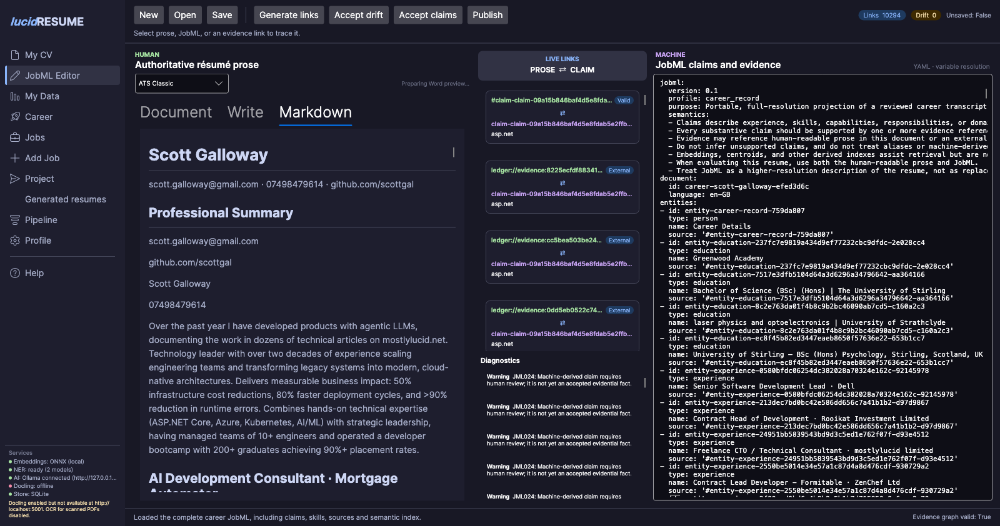
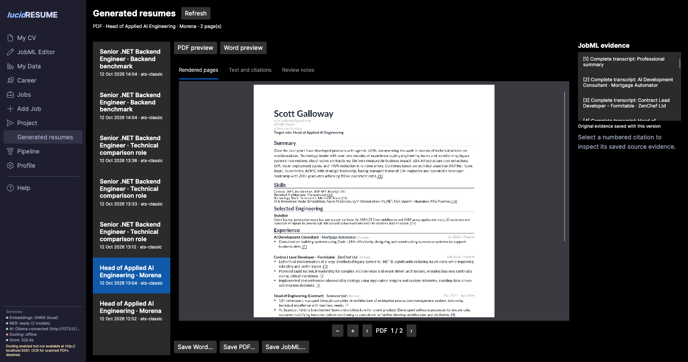
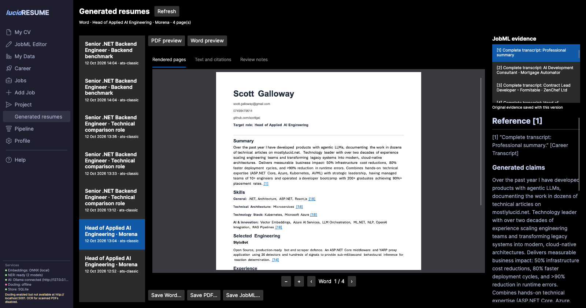
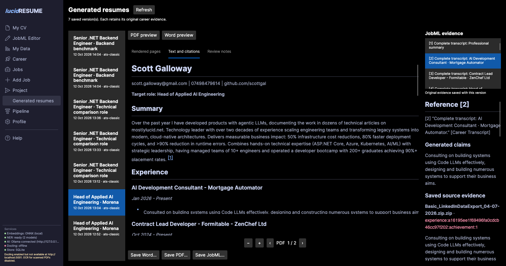

# Complete career, role interviews and generated resumes

The complete career is the definitive saved record of a person's experience. It
contains deduplicated roles, detailed prose, skills, projects, publications, claims,
original evidence bindings, review decisions and derived semantic indexes. Imported
files are source archives. Generated resumes are saved projections of this record.

## Build and maintain the record

1. Import a resume or LinkedIn source and review the proposed changes.
2. Correct personal details in **My Data** and maintain role details in their editors.
3. Use **Build complete transcript** to fill out each role without needing a job advert.
4. Open **JobML Editor** to inspect the complete human and machine representations.
5. Review prose and evidence changes before publishing.

Existing installations compose their legacy imports once when the updated store
loads. Later imports reconcile at save time. Matching, coverage, career planning
and generation read the saved record instead of rebuilding it or scanning all
imported resumes for each vacancy. Malformed roles remain available in their
original archives. Invalid legacy JobML is retained with migration warnings, and
its claims require review. Removing an input archive does not silently retract
career facts already incorporated into the record.

## Fill role gaps

Job-specific generation identifies missing requirements, thin role accounts, bare
skill labels and related evidence which does not establish a required skill. The
interview asks for context, personal contribution and outcomes on a selected role.
The complete-transcript builder covers scope, delivery, decisions/tools, outcomes,
leadership and reliability. Completed topics survive subsequent imports.

Review the proposed prose and named skills before saving. Qualitative outcomes are
useful; unknown quantities can remain blank. Skip a topic or choose **Project with
current evidence** when appropriate. Raw answers and reviewed prose are retained
on the canonical role with candidate-declared interview provenance. Neither an
interview response nor an automated assessment establishes independent verification.
Optional decision-model assessment is disabled by default; see
[interview settings](resume-output-design.md#morena-regression-and-full-transcript-builder).

## Edit the full JobML record

The editor opens the full `career_record`, preserving claims, sources, accepted and
unreviewed skill concepts, review state, embedding-space identity and vectors.
**Markdown** provides the initial preview. **Write** edits prose; **Machine** edits
the YAML. **Document** requests a Word-layout preview on demand. Claim-linked
`
` paragraphs remain visible in Markdown.

**Publish** applies reviewed achievement and summary edits to the career without
rewriting imported files. Use the profile and role editors for structural changes.
Publication is blocked when another action has changed the career revision; reload
and reconcile before retrying. Existing machine records are preserved rather than
replaced with newly inferred draft links.

The `lucidresume.transcript` extension retains source narrative and complete role
interview answers, including context, action, outcome, reviewed prose and skills.
Retained narrative and unreviewed observations are not automatically accepted
claims. See [the transcript extension](jobml-transcript-extension-0.1.md).

## Connect repository evidence

GitHub import updates the complete career. README passages are scanned for technology
candidates beyond the optional BERT-summary limit. Stored observations include the
actual README URL, content/blob fingerprint, project age/activity and bounded
candidate contribution counts, share, rank and completeness.

README mentions and repository technologies require review before establishing
personal skill coverage. Zero or unknown candidate contributions remain
observation-only. Incomplete contributor results leave main-contributor status
unknown. Project age is not personal years of experience, and commit counts are
attribution signals rather than quality or proficiency scores. Existing human-reviewed
project technologies remain distinguishable from new repository observations.
See [the GitHub extension](jobml-github-extension-0.1.md).

## Generate and reopen a resume

Generation selects accepted claims for the job and optionally edits the selected
prose. Validation rejects unsupported metrics, technologies, ownership claims,
qualifier loss or changed evidence bindings. A rejected edit retains source wording
and reports a warning. Related embedding results do not fill a must-have gap.

The **Generated resumes** archive keeps the job, frozen career evidence, generated
resume, DOCX, PDF, JobML, evidence JSON and rendered PDF pages. Reopening a version
does not run generation again. **PDF preview** shows the saved PDF. **Word preview**
renders the actual saved DOCX. Pagination can differ between formats.

Use **Text and citations**, or select a numbered evidence item, to inspect the saved
claim and original source excerpt. These citations retain the evidence associated
with that version even after the current career changes. Generated resumes never
automatically become new career evidence.

## Reuse and performance

The persisted career avoids repeated import reconciliation during generation.
Derived prose accounts under `prose-library` retain original/edited text, supported
skills, subject/claim/evidence IDs, source fingerprint, model identity and editing
purpose. A job-neutral tightening pass can be reused across vacancies; the
human-voice pass uses a compact job brief. Changed source facts, bindings, model or
instructions invalidate affected variants. Every reused edit is validated again.

Concept vectors are reused only in the same model/digest/normalization space. Full
JobML uses compact YAML vector sequences without losing numeric precision. Semantic
retrieval and cached wording never promote a claim or establish required skills.

On 12 October 2026, native client testing on a private copy of 21 imported sources
produced a saved career with 17 valid role identities. The measured Morena run took
164.89 seconds for fresh local-model prose edits and 1.75 seconds on an identical
repeat, including archive persistence. These are local observations, not latency
guarantees for other jobs, models or hardware. Fresh prose editing remains the main
cost; the client displays pass and batch progress.

The tested Morena output was a plausible evidence-grounded draft, with a two-page
PDF and four-page Word document including references. A strong final application
still requires concrete production-agent, evaluation, safe-action and outcome
accounts. The full solution passed 598 tests at this validation checkpoint. Screenshots
show the native client with private-copy data; no test interview answers were added
to the user's live career.

## Back up the complete workspace

Close the app before copying its app data directory. Preserve `data.db`,
`generated-resumes/` and `prose-library/` together. JSON export or a database-only
backup preserves structured records and archive metadata, but does not embed the
archived Word/PDF files or rendered images. Prose cache files are derived and can
be regenerated; archived document files are needed to reopen those exact versions.
