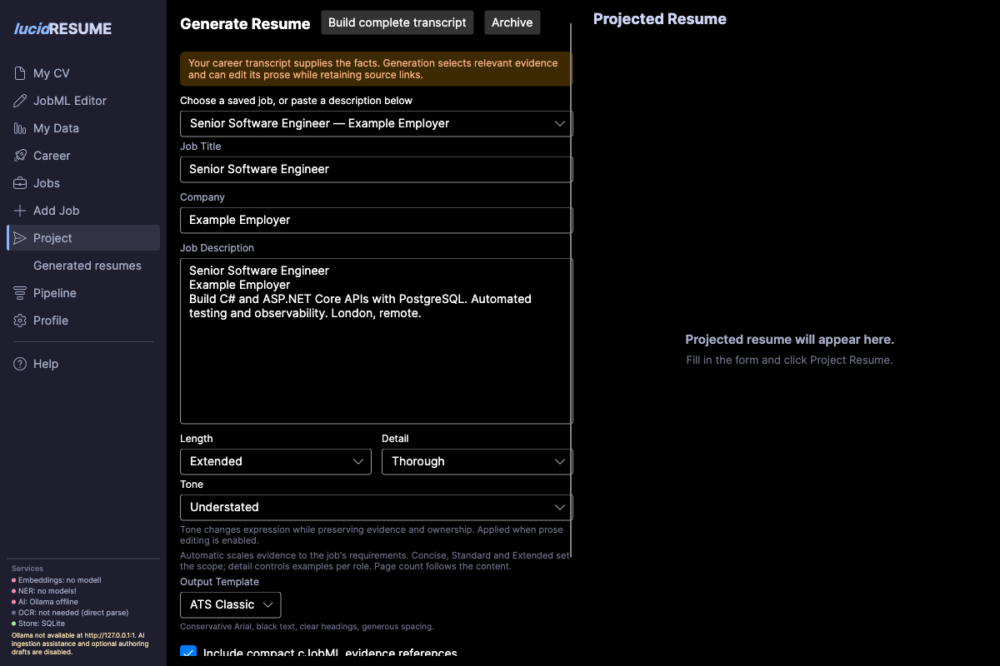
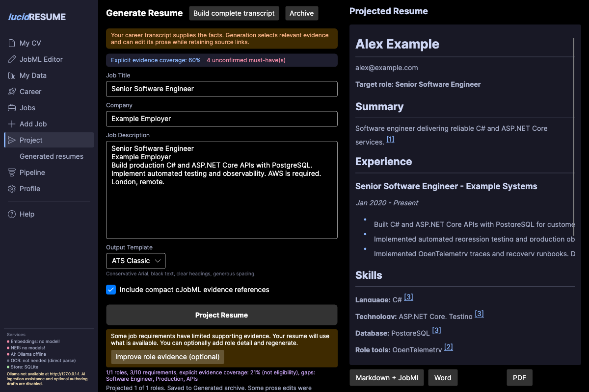
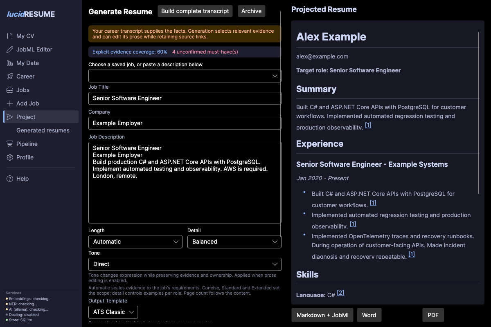
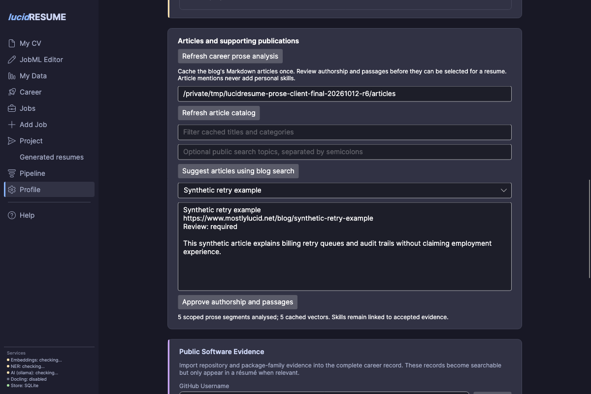

# Complete career, role interviews and generated resumes

The complete career is the definitive saved record of a person's experience. It
contains deduplicated roles, detailed prose, skills, projects, publications, claims,
original evidence bindings, review decisions and derived semantic indexes. Imported
files are source archives. Generated resumes are saved projections of this record.

## Build and maintain the record

1. Import a resume or LinkedIn source and review the proposed changes.
2. Correct personal details in **My Data** and maintain role details in their editors.
3. Use **Build complete transcript** to fill out each role without needing a job advert.
4. Open **JobML Editor** to inspect the complete human and machine representations.
5. Review prose and evidence changes before publishing.

Existing installations compose their legacy imports once when the updated store
loads. Later imports reconcile at save time. Matching, coverage, career planning
and generation read the saved record instead of rebuilding it or scanning all
imported resumes for each vacancy. Malformed roles remain available in their
original archives. Invalid legacy JobML is retained with migration warnings, and
its claims require review. Removing an input archive does not silently retract
career facts already incorporated into the record.

## Select a job and control the output

After adding a job, choose **Project resume for added job**, or open **Jobs**,
select a role and choose **Project Resume**. The projection page also offers a
saved-job selector. These routes carry the saved job's identity, description and
requirements into generation and its archived result.

**Length** offers Automatic, Concise, Standard and Extended. Automatic scales the
evidence budget with distinct job requirements. **Detail** controls the depth of
supported examples; **Tone** offers Direct, Understated and Expressive when prose
editing is enabled. Tone changes expression while preserving ownership, facts and
uncertainty. Preferences are retained with each generated version. Available evidence
determines the actual output size; these controls do not fabricate extra material.

Word now flows naturally across A4 pages, and PDF roles can flow across page
boundaries. Generation no longer forces a page break after an arbitrary role count.

See the [prose and related-work research spike](research/2026-10-12-evidence-preserving-prose.md)
for the analysed-prose pipeline, NLP diagnostics, blog discovery and concise related GitHub links.

## Optional evidence interview

Job-specific generation identifies missing requirements, thin role accounts, bare
skill labels and related evidence which does not establish a required skill. The
resume always projects from the available evidence; unanswered topics never block
generation. A warning highlights gaps and **Improve role evidence (optional)** opens
the interview after projection. **Back to projected resume** returns immediately
without answering or regenerating. The interview asks for context, personal
contribution and outcomes on a selected role.

The complete-transcript builder covers scope, delivery, decisions/tools, outcomes,
leadership and reliability. Completed topics survive subsequent imports.

Review the proposed prose and named skills before saving. Qualitative outcomes are
useful; unknown quantities can remain blank. Answer only useful topics, then
regenerate when you want the saved detail included. Raw answers and reviewed prose are retained
on the canonical role with candidate-declared interview provenance. Neither an
interview response nor an automated assessment establishes independent verification.
Optional decision-model assessment is disabled by default; see
[interview settings](resume-output-design.md#morena-regression-and-full-transcript-builder).

## Edit the full JobML record

The editor opens the full `career_record`, preserving claims, sources, accepted and
unreviewed skill concepts, review state, embedding-space identity and vectors.
**Markdown** provides the initial preview. **Write** edits prose; **Machine** edits
the YAML. **Document** requests a Word-layout preview on demand. Claim-linked
`
` paragraphs remain visible in Markdown.

**Publish** applies reviewed achievement and summary edits to the career without
rewriting imported files. Use the profile and role editors for structural changes.
Publication is blocked when another action has changed the career revision; reload
and reconcile before retrying. Existing machine records are preserved rather than
replaced with newly inferred draft links.

The `lucidresume.transcript` extension retains source narrative and complete role
interview answers, including context, action, outcome, reviewed prose and skills.
Retained narrative and unreviewed observations are not automatically accepted
claims. See [the transcript extension](jobml-transcript-extension-0.1.md).

## Connect repository evidence

GitHub import updates the complete career. README passages are scanned for technology
candidates beyond the optional BERT-summary limit. Stored observations include the
actual README URL, content/blob fingerprint, project age/activity and bounded
candidate contribution counts, share, rank and completeness.

README mentions and repository technologies require review before establishing
personal skill coverage. Zero or unknown candidate contributions remain
observation-only. Incomplete contributor results leave main-contributor status
unknown. Project age is not personal years of experience, and commit counts are
attribution signals rather than quality or proficiency scores. Existing human-reviewed
project technologies remain distinguishable from new repository observations.
See [the GitHub extension](jobml-github-extension-0.1.md).

## Generate and reopen a resume

Generation selects accepted claims for the job and optionally edits the selected
prose. Validation rejects unsupported metrics, technologies, ownership claims,
qualifier loss or changed evidence bindings. A rejected edit retains source wording
and reports a warning. Related embedding results do not fill a must-have gap.

The **Generated resumes** archive keeps the job, frozen career evidence, generated
resume, DOCX, PDF, JobML, evidence JSON and rendered PDF pages. Reopening a version
does not run generation again. **PDF preview** shows the saved PDF. **Word preview**
renders the actual saved DOCX. Pagination can differ between formats.

Use **Text and citations**, or select a numbered evidence item, to inspect the saved
claim and original source excerpt. These citations retain the evidence associated
with that version even after the current career changes. Generated resumes never
automatically become new career evidence.

## Reuse and performance

The persisted career avoids repeated import reconciliation during generation.
Derived prose accounts under `prose-library` retain original/edited text, supported
skills, subject/claim/evidence IDs, source fingerprint, model identity and editing
purpose. A job-neutral tightening pass can be reused across vacancies; the
human-voice pass uses a compact job brief. Changed source facts, bindings, model or
instructions invalidate affected variants. Every reused edit is validated again.

Concept vectors are reused only in the same model/digest/normalization space. Full
JobML uses compact YAML vector sequences without losing numeric precision. Semantic
retrieval and cached wording never promote a claim or establish required skills.

On 12 October 2026, native client testing on a private copy of 21 imported sources
produced a saved career with 17 valid role identities. The measured Morena run took
164.89 seconds for fresh local-model prose edits and 1.75 seconds on an identical
repeat, including archive persistence. These are local observations, not latency
guarantees for other jobs, models or hardware. Fresh prose editing remains the main
cost; the client displays pass and batch progress.

The tested Morena output was a plausible evidence-grounded draft, with a two-page
PDF and four-page Word document including references. A strong final application
still requires concrete production-agent, evaluation, safe-action and outcome
accounts. The full solution passed 598 tests at this validation checkpoint. Screenshots
show the native client with private-copy data; no test interview answers were added
to the user's live career.

## Back up the complete workspace

Close the app before copying its app data directory. Preserve `data.db`,
`generated-resumes/` and `prose-library/` together. JSON export or a database-only
backup preserves structured records and archive metadata, but does not embed the
archived Word/PDF files or rendered images. Prose cache files are derived and can
be regenerated; archived document files are needed to reopen those exact versions.

## Reusable analysed prose and related work

The saved career has a prose index containing original accepted passages, scoped
skills, reviewed contribution accounts, evidence links and reusable embeddings.
Generation selects complementary passages for the job's individual requirements,
combines compatible facts within a role, then asks the writer to synthesize natural
prose. Exact duplicates retain all their evidence bindings. Changing jobs or tone
reuses unchanged analysis; rejected claims and changed skills invalidate selection.

When two suitable selected accounts fit the summary budget, the summary draws on
those job-relevant facts and carries their original claim bindings. A generic
personal introduction is retained alongside them only when it is at least as
relevant as the strongest selected account. Skills are filtered against the job,
matched skills and explicit leadership/AI priorities; an incidental tool in a
selected role does not automatically enter the global skills list. The complete
career and role technology records retain the source detail.

The client and prose evaluation use the same writing policy for Direct, Understated
and Expressive tone and Brief/Balanced/Thorough detail. Detail changes how selected
facts are combined; it does not permit an action's purpose or uncertainty to disappear.
Composition checks the substance of each represented claim and explicit purpose
clauses, as well as skills, numbers and ownership. A rejected first edit supplies
specific repair instructions to the existing second pass. Cached rejections preserve
those instructions and do not count as successful edits. Both cached prose providers
include the validation policy in their cache identities.

Local responses containing one explicit `{sectionId, text}` object can be recovered
without guessing an identity. Empty, unbound, duplicated or unexpected sections
still fail the normal binding checks. Outcome limitations use explicit activity
subjects, rather than an ambiguous “environment, which did not measure”. These
conservative checks retain human prose
when an edit is ambiguous; they are not a general semantic entailment model.
Checks also retain unknown outcomes and explicit team construction, protect personal
deployment/review actions from reassignment, and preserve directed numeric changes
with their units. A measured result cannot supply an unstated purpose opening.
Embeddings help retrieve passages and do not establish proficiency.

Long bullets wrap within the native preview, including their evidence links.

Imports and reviewed edits now update retained term counts, corpus frequencies,
TF-IDF and the SQLite full-text index when the definitive career is saved. Only
changed full-text rows are replaced. Embeddings are enriched outside the database
lock and unchanged text is reused; stale model results cannot overwrite newer edits.
Generation combines sparse, full-text and available dense retrieval within role
boundaries. Requirement matches guide selection and never establish proficiency.
Long postings use a bounded query set while the full requirement set remains
available to each section's evidence plan. The plan distinguishes missing terms
from source-supported wording; the writer must not fill those gaps with facts.

In **Profile**, **Refresh career prose analysis** updates this derived index. A
legacy record's first projection can also build it automatically. Missing models leave lexical
retrieval available, and unanswered interview questions never block projection.

The **Articles and supporting publications** card imports a local blog Markdown
directory into the saved career. Refresh reuses unchanged articles and resets review
when their contents change. Filter titles/categories, inspect retained passages,
and approve authorship after checking the published URL. Optional search uses only
the supplied public topics. Generation reads cached evidence without crawling files,
GitHub or the blog again. Article technology mentions do not add personal skills.

Relevant accepted repository passages can appear as brief **Related projects** links;
a project already explained at length is excluded from this section. Related articles
are selected by requirement relevance rather than recency alone. Markdown, Word, PDF,
the generated archive and JobML preserve the selected links and their evidence IDs.
The source record keeps their observed revisions and contributor observations.

