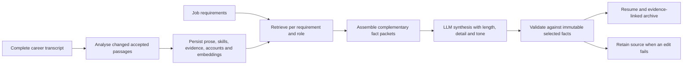

# Evidence-preserving resume prose: structure, tone and related work

**Date:** 12 October 2026  
**Status:** Research spike with implemented desktop retrieval/synthesis pipeline and regression evaluation
**Scope:** Contribution prose, optional interviews, tone, blog citations and related GitHub projects

## Abstract

A useful resume communicates what a person contributed, how they approached it and
what happened. Keyword overlap alone cannot supply that account. This spike proposes
a structured fact record beneath the prose, separate controls for length, detail and
expression, and small sets of relevant articles and repositories linked to their
supporting passages. The implementation direction is to reuse the complete career
transcript and refresh external sources incrementally. Neither a matching article
nor a repository technology mention establishes personal production experience.

This paper combines a design, a small retrieval experiment and implementation results. It does not report a hiring outcome study or a validated NLP classifier. The desktop paths below are implemented; semantic role labelling, NLI and blinded human quality ratings remain experiments.

## 1. The communication problem

There are three distinct failures to avoid: generic duties with no identifiable
contribution; energetic wording that exaggerates ownership or results; and a resume
whose content barely changes between different jobs. Requiring every missing field
before generation adds a fourth failure: the person cannot use the material they
already have. Generation should proceed, with an optional route to enrich the record.

The UK National Careers Service recommends describing situation, task, action and
result when explaining experience. We adapt that interview structure to short resume
passages rather than requiring four explicit headings in every bullet. This is a
design inference, not evidence that one sentence template improves hiring outcomes.
[National Careers Service: STAR](https://nationalcareers.service.gov.uk/careers-advice/interview-advice/the-star-method).

Our proposed default is **action + object + relevant decision/context + supported
result or current status**. A role header can carry context. A result can be
qualitative. An ongoing prototype should remain an ongoing prototype. If a source
does not contain an outcome, omit it and optionally ask about it.

For example, the synthetic source “I helped the team add a retry queue to the billing
service in C#; we had not measured the effect” can become “Helped add a C# retry queue
to the billing service; its effect had not yet been measured.” It cannot become
“Led a billing transformation that eliminated payment failures.”

## 2. Store the account before rewriting it

The complete transcript should retain reviewed prose and structured fields together:

| Field | Purpose |
|---|---|
| Actor and ownership | Individual, team, assisted, led; preserve the actual boundary. |
| Action and object | What changed, was built, investigated or operated. |
| Context and decision | Constraints, alternatives and the candidate's reasoning. |
| Outcome and status | Observed result, intended result, prototype, deployed, ongoing. |
| Skills and technologies | Accepted identifiers plus their actual source mentions. |
| Qualifiers | Uncertainty, negation, dates, scope and measurement limitations. |
| Provenance | Role/project ID, claim IDs, evidence IDs, passage/revision and review state. |

These fields need not all be present. Interviews should ask about the highest-value
missing field for the target role: “What did you personally implement?”, “What made
that choice difficult?” or “How did you know it worked?” Answers augment the same
role record after review. They should not create a parallel, disconnected biography.

Cache a neutral account by the source revision, selected claims, accepted skills,
model identity and writing-policy version. Cache its job-specific rendition with the
job identity and length/detail/tone preferences as well. Changing tone should not
trigger another scan of imported resumes, another GitHub import or new embeddings.

The native writer audit found that selected claims existed in the composition
manifest but its Ollama request exposed only flattened source prose. Passing the
section's claim statements, skills and evidence IDs makes that structure available
without sending unrelated roles. The accompanying prototype adds these fields and
removes a separate hard-coded 65-word summary ceiling. It retains validation and
source fallback; richer prompts do not establish factual correctness by themselves.

### 2.1 Implemented analysed-prose pipeline

The unit of reuse is an accepted passage in the complete career transcript, rather
than an imported document or a finished resume bullet. This follows the retained
segments, reusable vectors and relevance/diversity pattern in local DoomSummarizer
(`ArticleProcessor`, DocSummarizer `SegmentExtractor`). Career passages retain whole
accounts so splitting a sentence cannot detach a limitation from its claim.



`CareerProseIndex` stores original text, stable segment/content identities, role or
project scope, claim IDs, evidence IDs, accepted skills/concept identifiers, reviewed
contribution accounts, structural diagnostics and embedding-space identity. The
original text remains authoritative. Action/ownership/result diagnostics are simple
heuristics; they are not PropBank extraction or a proficiency assessment.

Analysis is query independent. Unchanged passages reuse their vectors across jobs.
Index validity includes source revision, accepted claim content, review decisions,
skill links, evidence IDs, embedding space and policy version. A review-only rejection
must remove a passage even when its original prose is unchanged. Model-file metadata
also participates in ONNX cache identity; it is not a cryptographic attestation.
The first refresh embeds at most 500 newly encountered accepted passages and retains
all eligible text. Explicit refresh can fill remaining vectors later. Unavailable
embeddings leave lexical retrieval usable. The profile exposes a refresh action;
projection performs a cached check and persists a newly built index when necessary.

`CareerProseRetriever` combines lexical and available semantic relevance, then rewards
coverage of distinct requirements and penalizes redundant examples. Diversity cannot
promote zero-relevance passages when relevant ones exist. Retrieval scores are not
skill coverage findings. Existing skill catalogue aliases and accepted declarations
remain the matching authority; embeddings serve passage discovery.

Exact duplicate accounts within one role share a segment but retain every claim and
support identity. Similar wording with a different fact is retained. Complementary
facts can enter one synthesis packet only within the same role and compatible
ownership/status classes. Conflicting metric values/directions and differences in explicit negation or measurement uncertainty prevent grouping. Every fact remains separately linked to the resulting
paragraph. This permits a natural new paragraph assembled from several supported
accounts, rather than a sequence of independent bullet rewrites. Personal projects
and publications are selected separately; they cannot migrate into an employer's
experience without an explicit career-record relationship.

The writer receives individual claim statements, named skills, evidence IDs and
reviewed structured accounts alongside immutable source prose. Validation checks
identities, skills, numbers, selected qualifiers, ownership upgrades, target-term
leakage and a conservative vocabulary-novelty budget. These checks cannot prove
entailment or completeness. A failed edit retains supported source prose and records
a warning. Optional interviews enrich the original role; missing fields never block
projection.

## 3. Where NLP helps

Semantic role labelling offers a representation of predicates and their arguments,
as illustrated by PropBank. Dependency parsing and semantic roles are plausible
ways to identify an action and its participants, then flag a passage which contains
only duties. They cannot establish whether the candidate actually performed the
action. Pronoun resolution and implied ownership remain difficult cases.
[Palmer, Gildea and Kingsbury, 2005](https://aclanthology.org/J05-1004/).

Use this as an **advisory diagnostic** over accepted transcript prose. Retain the
original passage and record extraction confidence. Missing structure can guide a
question; it should not block a resume or silently become a new claim.

For rewritten prose, check named entities, skills, numbers, dates, negation, modality,
ownership and deployment status. “Designed to reduce latency” and “reduced latency”
share most words but assert different facts. Embedding similarity is consequently
unsuitable as the sole acceptance test or as evidence of a skill.

Sentence-level natural-language inference is worth testing as a secondary warning.
SummaC demonstrates that granularity matters when detecting inconsistencies in
summaries. Its benchmark is not resume prose, so its results do not justify a
certification threshold here. Contradiction scores should supplement provenance and
explicit checks, with human review and source fallback for unresolved cases.
[Laban et al., 2022](https://aclanthology.org/2022.tacl-1.10/).

Do not add a parser or NLI model to every generation request yet. First compare its
diagnostic value and latency on a fixed set of career passages, including difficult
ownership and hypothetical-result examples.

## 4. Tone is expression, not claim strength

Style-transfer research treats preservation of meaning as a separate requirement
from changing style, and shows how an apparent style change can alter semantics.
This directly motivates bounded expression controls rather than an “impressiveness”
slider. [Krishna, Wieting and Iyyer, 2020](https://aclanthology.org/2020.emnlp-main.55/).

| Control | Changes | Must preserve |
|---|---|---|
| Length | Number of selected roles, examples and supporting links | Career chronology and selected evidence identities. |
| Detail | Depth of supported explanation per selected role | Actual contribution and known limitations. |
| Tone | Sentence rhythm, emphasis and verbal economy | Facts, ownership, uncertainty and outcome status. |

The prototype offers **Direct**, **Understated** and **Expressive**. Direct uses plain,
active phrasing. Understated reduces rhetorical emphasis. Expressive allows more
variation in rhythm and puts the supported contribution first. It must not add
superlatives, invented impact, personal enthusiasm or upgraded responsibility.

Illustrative, manually written variants of one synthetic fact:

- Understated: “Contributed a retry queue to the C# billing service; the effect had
  not yet been measured.”
- Direct: “Helped add a C# retry queue to the billing service; its effect had not
  yet been measured.”
- Expressive: “For the billing service, helped add a C# retry queue; its effect
  had not yet been measured.”

The differences are deliberately modest. Tone cannot rescue missing evidence.
Evaluation should score style intensity, content preservation and naturalness
separately, following the separation proposed by Mir and colleagues. These examples
are not model evaluation results. [Mir et al., 2019](https://aclanthology.org/N19-1049/).

## 5. Blog discovery: API and local corpus pilot

The blog source exposes these routes, checked against live responses on this date:

| Route | Observed behavior | Integration implication |
|---|---|---|
| `/search/semantic?query=…&limit=5` | JSON objects containing `slug` and `score` | Candidate retrieval only; no title or supporting passage. |
| `/blog/categories?language=en` | JSON `name` / `postCount` entries; 281 returned | Discovery facets, not a controlled skill taxonomy. |
| `/search?query=…&category=…&language=en` | HTML search; source uses hybrid search | Human fallback; not a documented JSON hybrid endpoint. |
| `/search/related/{slug}/en?limit=5` | Source enriches semantic neighbors with title/date/categories | Useful expansion, but still needs claim-relevant passages. |

The related route was inspected in source, not exercised in this pilot. Semantic
search can legitimately return an empty list when disabled; an integration must not
interpret that as evidence that no relevant articles exist. A Python urllib request
received HTTP 403 while curl succeeded, so client/header compatibility needed testing. A later check through the actual .NET service returned nine candidate slugs for two public topics and verified the agent-architecture article in approximately 1.77 seconds. Candidate quality is still unlabelled.
No authentication or server configuration was changed.

Reproduce local discovery without network access:

```sh
python3 scripts/research-publication-matching.py \
  --markdown-root /path/to/Mostlylucid/Markdown \
  --as-of 2026-10-12 \
  --query 'agent orchestration context retrieval memory tool execution state management safety evaluation observability model routing production reliability' \
  --output /tmp/article-candidates.json
```

The standalone script [research-publication-matching.py](../../scripts/research-publication-matching.py)
reads the supplied local Markdown directory. It recognizes the actual title,
`datetime` and category-comment format, excludes future-dated and translated files,
and produces deterministic candidate URLs with content hashes and two matching
passages. It does not contact the site or modify the career database. Local presence
is not proof of publication; output explicitly marks URLs unverified.

One Morena-inspired query used these terms:

```text
agent orchestration context retrieval memory tool execution state management
safety evaluation observability model routing production reliability
```

Observed pilot: 807 eligible local articles were indexed and ranked in approximately
294 ms in one run. That includes file reading and is not a production latency
benchmark. The algorithm weights query terms by corpus rarity, title matches ×3,
category matches ×2 and the two strongest prose passages ×1. There is no stemming,
synonym expansion, model call or embedding computation.

| Rank | Local lexical candidate | Live semantic candidate |
|---:|---|---|
| 1 | `why-i-dont-use-langchain` | `typescript-sdk` |
| 2 | `dotnet-geo-blocking-routing-library` | `stylobot-fingerprint` |
| 3 | `constrained-mom-mixture-of-models` | `sidecar-architecture` |
| 4 | `fire-and-dont-quite-forget-ephemeral-execution` | `stylobot-release-reliability` |
| 5 | `doomsummarizer-deep-research` | `botdetection-part2-signature-pipeline-and-stylobot-architecture` |

The lists have zero top-five overlap. This is a useful failure signal, not a ranking
winner: there are no relevance labels. “Routing” retrieves geographic routing in the
lexical baseline; the semantic list emphasizes bot infrastructure. A long blended
query obscures the requirement being supported. The next iteration should retrieve
per requirement, combine the candidate lists, then assess the actual passages.

Three local candidates have accessible live article pages: the
[agent architecture discussion](https://www.mostlylucid.net/blog/why-i-dont-use-langchain),
[model coordination discussion](https://www.mostlylucid.net/blog/constrained-mom-mixture-of-models)
and [DoomSummarizer article](https://www.mostlylucid.net/blog/doomsummarizer-deep-research).
Their existence establishes publication availability, not the validity of every
technical statement or a production deployment claim.

The profile now imports and caches article metadata/passages once, keyed by canonical
URL and content hash. Categories help discovery; accepted skill aliases come from our
skill catalogue. Use semantic search to expand candidates where useful, then show
why each article matches a specific requirement. Publication approval verifies the live URL and persists authored-publication evidence in the complete transcript. A content change resets approval. The optional semantic API search sends supplied public topics; generation itself reads the saved catalogue without file or network access. Never make publishing an article automatically
declare every technology it mentions as a personal skill.

## 6. GitHub: concise related projects

Each resume can include a small **Related projects** section, tailored independently
of its full project narratives. Proposed presentation: linked name, one short
evidence-backed relevance phrase and optional attribution. Select two to four useful
links within the length budget; prefer fewer when evidence is weak. Avoid repeating
a project already explained at length in the same document.

Existing GitHub import models already retain README skills, observed revision,
creation/last-push dates, forks, contribution observations and engineering signals.
The assessment explicitly ranks evidence sources rather than personal proficiency.
Reuse those records. Resume generation should not crawl every repository again.

Rank by supported requirement coverage and README passage specificity first. Use
observed contributions, recency and engineering signals as tie-breakers; stars and
repository age cannot establish competence. Creation-to-last-push span is not years
of continuous personal work. A non-fork under an account is not sufficient proof
that the candidate wrote it. Unknown contributor coverage stays unknown.

Store each related link with repository ID/URL, revision, supporting passage,
requirement IDs, contribution observation and review state. The visible resume can
remain brief while JobML and the archive expose that evidence. Do not attach a
personal repository to an employer role unless the transcript establishes the
relationship. The desktop selector now uses accepted cached passages, stores supporting claim/evidence IDs in `RelatedWork`, and renders the concise links in Markdown, Word and PDF. The generated archive preserves those links, and the JobML `lucidresume.related_work` extension exposes the support. Relevant publications use the same selection path.

## 7. Next experiment and acceptance criteria

Use six reviewed synthetic fact packets spanning assisted work, leadership,
prototype status, uncertain impact, absent metrics and measured results. Generate
three tones at two detail levels: 36 outputs per provider. Compare matched outputs
blind for clarity, specificity, naturalness and desired tone. Repeat selection for
two substantially different jobs without changing the facts. Record latency, model
identity, validation failures, source fallbacks and cache hits separately.

For retrieval, manually label article/repository passages against individual Morena
requirements and a contrasting job. Compare lexical, semantic and combined retrieval
at the same candidate budget. Measure precision, coverage, duplicate evidence and
unsupported personal-attribution rate. Do not promote the current unlabelled score
to an app “fit” percentage.

Provisional acceptance: no known ownership/status/number corruption in fixtures;
every emitted link resolves to its retained evidence record; relevant skills survive
rewrites; article mentions never create employment claims; generation remains
available when optional questions are unanswered. These are regression criteria,
not a guarantee about arbitrary generated text.

The immediate recommendation is to improve structured inputs and reuse first,
keep tone bounded, and run a labelled passage-level pilot before introducing another
runtime NLP model. A resume should communicate the candidate's actual work more
clearly while letting the reader follow a small number of relevant links.


## 8. Implementation evaluation and limits

The synthetic evaluation tool is `tools/lucidRESUME.ProseEvaluation`. It records
model identity, elapsed time, warnings, unchanged source, validation errors and
repeat-cache behavior separately. An unchanged output is not necessarily a fallback:
a model can return the original wording and pass validation.

The initial qwen3.5:0.8b run produced 36 outputs across six facts, three tones and two
detail levels. Twenty-eight were unchanged; median latency was approximately 1.67 s
and the repeated cached case took 9 ms. Luna review found one accepted embellishment:
“high load periods” was added to an account which only described reviewing recovery
designs. The previous overlap gate did not catch it. A regression and conservative
novel-content gate were added. Thus zero errors from the old validator did **not**
establish factual grounding or good prose.

A follow-up uses two richer multi-claim packets and qwen3.5:4b (12 outputs). This is
still too small and unlabelled to establish writing quality. Initial results revealed
both over-strict lexical checks rejecting harmless paraphrases and malformed local
model responses. Validation now normalizes punctuation, permits “unmeasured” for
“not measured”, and distinguishes explicit uncertain outcomes from capability wording.
Malformed response fields produce a clear fallback warning. The tool keeps the
originals and warnings so these trade-offs remain inspectable.

The final richer-packet run changed eight of twelve outputs; four retained source wording. Five cases recorded a rejected edit or malformed-response warning. Median elapsed time was approximately 5.42 s; the repeat was served from cache. The retry example now combines storage and audit-trail facts into one paragraph while retaining its unmeasured result. Luna review found that the compact retry paragraphs lose the specific purpose “inspect failed attempts”; accepted wording is therefore not a completeness guarantee. Tone differences remain small, and malformed responses remain an observed limitation of this local model configuration. Synthetic outputs and run metadata are retained in `docs/research/results/`.

The implementation has regressions for incremental embeddings, model-space changes,
review-only rejection, scoped deduplication, requirement diversity, multi-claim prose
bindings, publication refresh/review, offline discovery and related-link exports.
The native client harness also exercises catalogue refresh and persisted prose analysis
in an isolated SQLite store. Human ratings, labelled retrieval relevance, general
claim entailment and real hiring outcomes remain unmeasured. Adding SRL, TextRank or
NLI to the runtime requires a separate accuracy/latency comparison; this patch does
not silently add those models.


Final Release validation passed 628 .NET tests across twelve projects and fifteen
native desktop workflow groups against an isolated synthetic SQLite store. The
build reported zero warnings and errors. Generated Word/PDF related links have
export regressions, and the native workflows cover saved-job projection, interviews,
JobML, archives, persistence, contrasting jobs, cached publications and prose-index
refresh. This is regression coverage, not a claim that every career or provider
produces an excellent resume.
