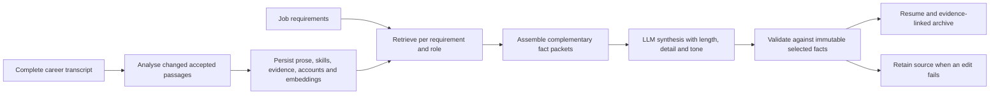
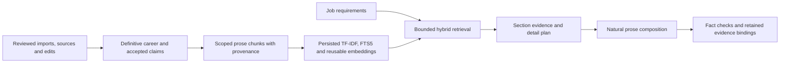

# Evidence-preserving resume prose: structure, tone and related work

**Date:** 12 October 2026  
**Status:** Research spike with implemented desktop retrieval/synthesis pipeline and regression evaluation
**Scope:** Contribution prose, optional interviews, tone, blog citations and related GitHub projects

## Abstract

A useful resume communicates what a person contributed, how they approached it and
what happened. Keyword overlap alone cannot supply that account. This spike proposes
a structured fact record beneath the prose, separate controls for length, detail and
expression, and small sets of relevant articles and repositories linked to their
supporting passages. The implementation direction is to reuse the complete career
transcript and refresh external sources incrementally. Neither a matching article
nor a repository technology mention establishes personal production experience.

This paper combines a design, a small retrieval experiment and implementation results. It does not report a hiring outcome study or a validated NLP classifier. The desktop paths below are implemented; semantic role labelling, NLI and blinded human quality ratings remain experiments.

## 1. The communication problem

There are three distinct failures to avoid: generic duties with no identifiable
contribution; energetic wording that exaggerates ownership or results; and a resume
whose content barely changes between different jobs. Requiring every missing field
before generation adds a fourth failure: the person cannot use the material they
already have. Generation should proceed, with an optional route to enrich the record.

The UK National Careers Service recommends describing situation, task, action and
result when explaining experience. We adapt that interview structure to short resume
passages rather than requiring four explicit headings in every bullet. This is a
design inference, not evidence that one sentence template improves hiring outcomes.
[National Careers Service: STAR](https://nationalcareers.service.gov.uk/careers-advice/interview-advice/the-star-method).

Our proposed default is **action + object + relevant decision/context + supported
result or current status**. A role header can carry context. A result can be
qualitative. An ongoing prototype should remain an ongoing prototype. If a source
does not contain an outcome, omit it and optionally ask about it.

For example, the synthetic source “I helped the team add a retry queue to the billing
service in C#; we had not measured the effect” can become “Helped add a C# retry queue
to the billing service; its effect had not yet been measured.” It cannot become
“Led a billing transformation that eliminated payment failures.”

## 2. Store the account before rewriting it

The complete transcript should retain reviewed prose and structured fields together:

| Field | Purpose |
|---|---|
| Actor and ownership | Individual, team, assisted, led; preserve the actual boundary. |
| Action and object | What changed, was built, investigated or operated. |
| Context and decision | Constraints, alternatives and the candidate's reasoning. |
| Outcome and status | Observed result, intended result, prototype, deployed, ongoing. |
| Skills and technologies | Accepted identifiers plus their actual source mentions. |
| Qualifiers | Uncertainty, negation, dates, scope and measurement limitations. |
| Provenance | Role/project ID, claim IDs, evidence IDs, passage/revision and review state. |

These fields need not all be present. Interviews should ask about the highest-value
missing field for the target role: “What did you personally implement?”, “What made
that choice difficult?” or “How did you know it worked?” Answers augment the same
role record after review. They should not create a parallel, disconnected biography.

Cache a neutral account by the source revision, selected claims, accepted skills,
model identity and writing-policy version. Cache its job-specific rendition with the
job identity and length/detail/tone preferences as well. Changing tone should not
trigger another scan of imported resumes, another GitHub import or new embeddings.

The native writer audit found that selected claims existed in the composition
manifest but its Ollama request exposed only flattened source prose. Passing the
section's claim statements, skills and evidence IDs makes that structure available
without sending unrelated roles. The accompanying prototype adds these fields and
removes a separate hard-coded 65-word summary ceiling. It retains validation and
source fallback; richer prompts do not establish factual correctness by themselves.

### 2.1 Implemented analysed-prose pipeline

The unit of reuse is an accepted passage in the complete career transcript, rather
than an imported document or a finished resume bullet. This follows the retained
segments, reusable vectors and relevance/diversity pattern in local DoomSummarizer
(`ArticleProcessor`, DocSummarizer `SegmentExtractor`). Career passages retain whole
accounts so splitting a sentence cannot detach a limitation from its claim.



`CareerProseIndex` stores original text, stable segment/content identities, role or
project scope, claim IDs, evidence IDs, accepted skills/concept identifiers, reviewed
contribution accounts, structural diagnostics and embedding-space identity. The
original text remains authoritative. Action/ownership/result diagnostics are simple
heuristics; they are not PropBank extraction or a proficiency assessment.

Analysis is query independent. Unchanged passages reuse their vectors across jobs.
Index validity includes source revision, accepted claim content, review decisions,
skill links, evidence IDs, embedding space and policy version. A review-only rejection
must remove a passage even when its original prose is unchanged. Model-file metadata
also participates in ONNX cache identity; it is not a cryptographic attestation.
The first refresh embeds at most 500 newly encountered accepted passages and retains
all eligible text. Explicit refresh can fill remaining vectors later. Unavailable
embeddings leave lexical retrieval usable. The profile exposes a refresh action;
projection performs a cached check and persists a newly built index when necessary.

`CareerProseRetriever` combines lexical and available semantic relevance, then rewards
coverage of distinct requirements and penalizes redundant examples. Diversity cannot
promote zero-relevance passages when relevant ones exist. Retrieval scores are not
skill coverage findings. Existing skill catalogue aliases and accepted declarations
remain the matching authority; embeddings serve passage discovery.

Exact duplicate accounts within one role share a segment but retain every claim and
support identity. Similar wording with a different fact is retained. Complementary
facts can enter one synthesis packet only within the same role and compatible
ownership/status classes. Conflicting metric values/directions and differences in explicit negation or measurement uncertainty prevent grouping. Every fact remains separately linked to the resulting
paragraph. This permits a natural new paragraph assembled from several supported
accounts, rather than a sequence of independent bullet rewrites. Personal projects
and publications are selected separately; they cannot migrate into an employer's
experience without an explicit career-record relationship.

The writer receives individual claim statements, named skills, evidence IDs and
reviewed structured accounts alongside immutable source prose. Validation checks
identities, skills, numbers, selected qualifiers, ownership upgrades, target-term
leakage and a conservative vocabulary-novelty budget. These checks cannot prove
entailment or completeness. A failed edit retains supported source prose and records
a warning. Optional interviews enrich the original role; missing fields never block
projection.

## 3. Where NLP helps

Semantic role labelling offers a representation of predicates and their arguments,
as illustrated by PropBank. Dependency parsing and semantic roles are plausible
ways to identify an action and its participants, then flag a passage which contains
only duties. They cannot establish whether the candidate actually performed the
action. Pronoun resolution and implied ownership remain difficult cases.
[Palmer, Gildea and Kingsbury, 2005](https://aclanthology.org/J05-1004/).

Use this as an **advisory diagnostic** over accepted transcript prose. Retain the
original passage and record extraction confidence. Missing structure can guide a
question; it should not block a resume or silently become a new claim.

For rewritten prose, check named entities, skills, numbers, dates, negation, modality,
ownership and deployment status. “Designed to reduce latency” and “reduced latency”
share most words but assert different facts. Embedding similarity is consequently
unsuitable as the sole acceptance test or as evidence of a skill.

Sentence-level natural-language inference is worth testing as a secondary warning.
SummaC demonstrates that granularity matters when detecting inconsistencies in
summaries. Its benchmark is not resume prose, so its results do not justify a
certification threshold here. Contradiction scores should supplement provenance and
explicit checks, with human review and source fallback for unresolved cases.
[Laban et al., 2022](https://aclanthology.org/2022.tacl-1.10/).

Do not add a parser or NLI model to every generation request yet. First compare its
diagnostic value and latency on a fixed set of career passages, including difficult
ownership and hypothetical-result examples.

## 4. Tone is expression, not claim strength

Style-transfer research treats preservation of meaning as a separate requirement
from changing style, and shows how an apparent style change can alter semantics.
This directly motivates bounded expression controls rather than an “impressiveness”
slider. [Krishna, Wieting and Iyyer, 2020](https://aclanthology.org/2020.emnlp-main.55/).

| Control | Changes | Must preserve |
|---|---|---|
| Length | Number of selected roles, examples and supporting links | Career chronology and selected evidence identities. |
| Detail | Depth of supported explanation per selected role | Actual contribution and known limitations. |
| Tone | Sentence rhythm, emphasis and verbal economy | Facts, ownership, uncertainty and outcome status. |

The prototype offers **Direct**, **Understated** and **Expressive**. Direct uses plain,
active phrasing. Understated reduces rhetorical emphasis. Expressive allows more
variation in rhythm and puts the supported contribution first. It must not add
superlatives, invented impact, personal enthusiasm or upgraded responsibility.

Illustrative, manually written variants of one synthetic fact:

- Understated: “Contributed a retry queue to the C# billing service; the effect had
  not yet been measured.”
- Direct: “Helped add a C# retry queue to the billing service; its effect had not
  yet been measured.”
- Expressive: “For the billing service, helped add a C# retry queue; its effect
  had not yet been measured.”

The differences are deliberately modest. Tone cannot rescue missing evidence.
Evaluation should score style intensity, content preservation and naturalness
separately, following the separation proposed by Mir and colleagues. These examples
are not model evaluation results. [Mir et al., 2019](https://aclanthology.org/N19-1049/).

## 5. Blog discovery: API and local corpus pilot

The blog source exposes these routes, checked against live responses on this date:

| Route | Observed behavior | Integration implication |
|---|---|---|
| `/search/semantic?query=…&limit=5` | JSON objects containing `slug` and `score` | Candidate retrieval only; no title or supporting passage. |
| `/blog/categories?language=en` | JSON `name` / `postCount` entries; 281 returned | Discovery facets, not a controlled skill taxonomy. |
| `/search?query=…&category=…&language=en` | HTML search; source uses hybrid search | Human fallback; not a documented JSON hybrid endpoint. |
| `/search/related/{slug}/en?limit=5` | Source enriches semantic neighbors with title/date/categories | Useful expansion, but still needs claim-relevant passages. |

The related route was inspected in source, not exercised in this pilot. Semantic
search can legitimately return an empty list when disabled; an integration must not
interpret that as evidence that no relevant articles exist. A Python urllib request
received HTTP 403 while curl succeeded, so client/header compatibility needed testing. A later check through the actual .NET service returned nine candidate slugs for two public topics and verified the agent-architecture article in approximately 1.77 seconds. Candidate quality is still unlabelled.
No authentication or server configuration was changed.

Reproduce local discovery without network access:

```sh
python3 scripts/research-publication-matching.py \
  --markdown-root /path/to/Mostlylucid/Markdown \
  --as-of 2026-10-12 \
  --query 'agent orchestration context retrieval memory tool execution state management safety evaluation observability model routing production reliability' \
  --output /tmp/article-candidates.json
```

The standalone script [research-publication-matching.py](../../scripts/research-publication-matching.py)
reads the supplied local Markdown directory. It recognizes the actual title,
`datetime` and category-comment format, excludes future-dated and translated files,
and produces deterministic candidate URLs with content hashes and two matching
passages. It does not contact the site or modify the career database. Local presence
is not proof of publication; output explicitly marks URLs unverified.

One Morena-inspired query used these terms:

```text
agent orchestration context retrieval memory tool execution state management
safety evaluation observability model routing production reliability
```

Observed pilot: 807 eligible local articles were indexed and ranked in approximately
294 ms in one run. That includes file reading and is not a production latency
benchmark. The algorithm weights query terms by corpus rarity, title matches ×3,
category matches ×2 and the two strongest prose passages ×1. There is no stemming,
synonym expansion, model call or embedding computation.

| Rank | Local lexical candidate | Live semantic candidate |
|---:|---|---|
| 1 | `why-i-dont-use-langchain` | `typescript-sdk` |
| 2 | `dotnet-geo-blocking-routing-library` | `stylobot-fingerprint` |
| 3 | `constrained-mom-mixture-of-models` | `sidecar-architecture` |
| 4 | `fire-and-dont-quite-forget-ephemeral-execution` | `stylobot-release-reliability` |
| 5 | `doomsummarizer-deep-research` | `botdetection-part2-signature-pipeline-and-stylobot-architecture` |

The lists have zero top-five overlap. This is a useful failure signal, not a ranking
winner: there are no relevance labels. “Routing” retrieves geographic routing in the
lexical baseline; the semantic list emphasizes bot infrastructure. A long blended
query obscures the requirement being supported. The next iteration should retrieve
per requirement, combine the candidate lists, then assess the actual passages.

Three local candidates have accessible live article pages: the
[agent architecture discussion](https://www.mostlylucid.net/blog/why-i-dont-use-langchain),
[model coordination discussion](https://www.mostlylucid.net/blog/constrained-mom-mixture-of-models)
and [DoomSummarizer article](https://www.mostlylucid.net/blog/doomsummarizer-deep-research).
Their existence establishes publication availability, not the validity of every
technical statement or a production deployment claim.

The profile now imports and caches article metadata/passages once, keyed by canonical
URL and content hash. Categories help discovery; accepted skill aliases come from our
skill catalogue. Use semantic search to expand candidates where useful, then show
why each article matches a specific requirement. Publication approval verifies the live URL and persists authored-publication evidence in the complete transcript. A content change resets approval. The optional semantic API search sends supplied public topics; generation itself reads the saved catalogue without file or network access. Never make publishing an article automatically
declare every technology it mentions as a personal skill.

## 6. GitHub: concise related projects

Each resume can include a small **Related projects** section, tailored independently
of its full project narratives. Proposed presentation: linked name, one short
evidence-backed relevance phrase and optional attribution. Select two to four useful
links within the length budget; prefer fewer when evidence is weak. Avoid repeating
a project already explained at length in the same document.

Existing GitHub import models already retain README skills, observed revision,
creation/last-push dates, forks, contribution observations and engineering signals.
The assessment explicitly ranks evidence sources rather than personal proficiency.
Reuse those records. Resume generation should not crawl every repository again.

Rank by supported requirement coverage and README passage specificity first. Use
observed contributions, recency and engineering signals as tie-breakers; stars and
repository age cannot establish competence. Creation-to-last-push span is not years
of continuous personal work. A non-fork under an account is not sufficient proof
that the candidate wrote it. Unknown contributor coverage stays unknown.

Store each related link with repository ID/URL, revision, supporting passage,
requirement IDs, contribution observation and review state. The visible resume can
remain brief while JobML and the archive expose that evidence. Do not attach a
personal repository to an employer role unless the transcript establishes the
relationship. The desktop selector now uses accepted cached passages, stores supporting claim/evidence IDs in `RelatedWork`, and renders the concise links in Markdown, Word and PDF. The generated archive preserves those links, and the JobML `lucidresume.related_work` extension exposes the support. Relevant publications use the same selection path.

## 7. Next experiment and acceptance criteria

Use six reviewed synthetic fact packets spanning assisted work, leadership,
prototype status, uncertain impact, absent metrics and measured results. Generate
three tones at two detail levels: 36 outputs per provider. Compare matched outputs
blind for clarity, specificity, naturalness and desired tone. Repeat selection for
two substantially different jobs without changing the facts. Record latency, model
identity, validation failures, source fallbacks and cache hits separately.

For retrieval, manually label article/repository passages against individual Morena
requirements and a contrasting job. Compare lexical, semantic and combined retrieval
at the same candidate budget. Measure precision, coverage, duplicate evidence and
unsupported personal-attribution rate. Do not promote the current unlabelled score
to an app “fit” percentage.

Provisional acceptance: no known ownership/status/number corruption in fixtures;
every emitted link resolves to its retained evidence record; relevant skills survive
rewrites; article mentions never create employment claims; generation remains
available when optional questions are unanswered. These are regression criteria,
not a guarantee about arbitrary generated text.

The immediate recommendation is to improve structured inputs and reuse first,
keep tone bounded, and run a labelled passage-level pilot before introducing another
runtime NLP model. A resume should communicate the candidate's actual work more
clearly while letting the reader follow a small number of relevant links.


## 8. Implementation evaluation and limits

The synthetic evaluation tool is `tools/lucidRESUME.ProseEvaluation`. It records
model identity, elapsed time, warnings, unchanged source, validation errors and
repeat-cache behavior separately. An unchanged output is not necessarily a fallback:
a model can return the original wording and pass validation.

The initial qwen3.5:0.8b run produced 36 outputs across six facts, three tones and two
detail levels. Twenty-eight were unchanged; median latency was approximately 1.67 s
and the repeated cached case took 9 ms. Luna review found one accepted embellishment:
“high load periods” was added to an account which only described reviewing recovery
designs. The previous overlap gate did not catch it. A regression and conservative
novel-content gate were added. Thus zero errors from the old validator did **not**
establish factual grounding or good prose.

A follow-up uses two richer multi-claim packets and qwen3.5:4b (12 outputs). This is
still too small and unlabelled to establish writing quality. Initial results revealed
both over-strict lexical checks rejecting harmless paraphrases and malformed local
model responses. Validation now normalizes punctuation, permits “unmeasured” for
“not measured”, and distinguishes explicit uncertain outcomes from capability wording.
Malformed response fields produce a clear fallback warning. The tool keeps the
originals and warnings so these trade-offs remain inspectable.

The earlier richer-packet run changed eight of twelve outputs; four retained source wording. Five cases recorded a rejected edit or malformed-response warning. Median elapsed time was approximately 5.42 s; the repeat was served from cache. The retry example combined storage and audit-trail facts into one paragraph while retaining its unmeasured result. Luna review found that the compact retry paragraphs lost the specific purpose “inspect failed attempts”; accepted wording was therefore not a completeness guarantee. Tone differences were small, and malformed responses remained an observed limitation of that configuration. Synthetic outputs and run metadata are retained in `docs/research/results/`.

The implementation has regressions for incremental embeddings, model-space changes,
review-only rejection, scoped deduplication, requirement diversity, multi-claim prose
bindings, publication refresh/review, offline discovery and related-link exports.
The native client harness also exercises catalogue refresh and persisted prose analysis
in an isolated SQLite store. Human ratings, labelled retrieval relevance, general
claim entailment and real hiring outcomes remain unmeasured. Adding SRL, TextRank or
NLI to the runtime requires a separate accuracy/latency comparison; this patch does
not silently add those models.


At the earlier checkpoint, Release validation passed 628 .NET tests across twelve projects and fifteen
native desktop workflow groups against an isolated synthetic SQLite store. The
build reported zero warnings and errors. Generated Word/PDF related links have
export regressions, and the native workflows cover saved-job projection, interviews,
JobML, archives, persistence, contrasting jobs, cached publications and prose-index
refresh. This is regression coverage, not a claim that every career or provider
produces an excellent resume.

### 8.1 Corrective iteration: detail, ownership and local response shape

Capturing the synthetic HTTP exchanges established that the failing local responses
were often complete `{sectionId, text}` objects, flattened out of the requested
`sections` array. The parser now recovers that explicit identity and text. It never
guesses an identity for unbound prose; normal completeness, duplicate and unknown-ID
checks still apply. Raw exchanges are saved only by the synthetic evaluation tool,
not by the application.

The client and evaluation now share `ResumeWritingPolicy`, rather than testing tone
enum names against different production instructions. Brief combines facts without
removing their action, object or purpose. Thorough retains supported implementation
detail and can use more sentences. Tone describes sentence openings, rhythm and
emphasis, with the same grounding restrictions for every voice.

Validation now checks that each represented claim retains substantive content and
that explicit purpose clauses retain their distinguishing detail. It permits
“unmeasured” and “without measuring” as bounded measurement-negation paraphrases.
A coordinated-action check prevents “led the team and reviewed designs” becoming
“led the team to review designs”. These are conservative lexical and grammatical
checks, not general SRL or entailment; novel paraphrases may still retain source
wording instead.

Luna's follow-up also caught an ambiguous relative clause: “in a test environment,
which did not measure production availability”. The policy now asks for explicit
subjects for limitations, and a narrow grammatical guard rejects this measurement
construction so the second pass can name the source activity. Understated tone asks
for short separate factual sentences; Expressive asks for a purpose opening when
the source supplies one. These controls change presentation, not the supported facts. The stronger style
instructions also exposed invented reliability/stability goals and “I”/“we”
attribution in model replies. Further checks reject unsupported purpose openings
and introduced personal or collective pronouns, while allowing purpose openings
that retain source-supported detail. Both passes use these same checks.

A cache bug had concealed rejected edits from the orchestrator: retained source
looked like an accepted edit, so the next pass did not receive repair instructions.
Both cached providers now carry a separate rejection reason through fresh and cached
responses. The existing second pass receives the precise error; rejected source
fallbacks do not count as successful composition. Cache keys include validation
policy version, and stable rejection reasons allow repaired outputs to be reused
without repeating model calls.

The corrective code passed 647 tests across twelve projects and all fifteen native
desktop workflow groups, using synthetic data and isolated SQLite storage.
The Release build reported zero warnings and errors. The final qwen3.5:4b matrix
changed eight of twelve paragraphs and retained accepted source prose in four.
All six retry cases preserve “inspect failed attempts” and the unmeasured result.
Every evaluation case preserves the separate leadership and personal review actions,
with explicit subjects for measurement limitations. No final output retains the
invented reliability/stability purpose or introduced I/we attribution observed in
the intermediate review. Six cases recorded rejected edits; two were repaired in
the second pass, while four retained the already well-formed source. No case ended
with a malformed-response failure. Median uncached latency was 9.78 s while other
validation ran on the same machine, so this is not evidence of a speed improvement.
The repeated case reused both passes in 15 ms. Results and model identity are in
[`prose-synthesis-fixes-2026-10-12.json`](results/prose-synthesis-fixes-2026-10-12.json)
and [`prose-synthesis-fixes-run-2026-10-12.json`](results/prose-synthesis-fixes-run-2026-10-12.json).
Tone remains deliberately bounded and some variants share sentences; these twelve
examples do not establish quality across a complete career or arbitrary providers.

### 8.2 Broader quality loop: scope, measurements and job relevance

The next iteration expanded from two complementary-fact shapes to six authored
synthetic families: internal production agents, manual offline evaluation, personal
deployment versus team construction, incident replay versus root-cause diagnosis,
two directed measurements with different units, and a cancelled document prototype.
Each was evaluated with Direct/Brief and Expressive/Thorough instructions using
qwen3.5:4b. An independent Luna review compared the actual text with the sources.
The executable and repeatable commands are documented in the
[evaluation guide](../../tools/lucidRESUME.ProseEvaluation/README.md).

The baseline changed seven of twelve passages but dropped “production effect
remains unknown” from an otherwise accurately described offline result. The first
correction retained that limitation; review then caught a different error:
“To measure test latency, PostgreSQL queries were optimised from 240 ms to 180 ms.”
This gives the action an unstated purpose and makes queries, rather than latency,
the apparent measured quantity. Number presence alone would accept that sentence.
The final gates require a source-stated purpose for that opening and preserve
directed `from/to` measurements with their units, including reversed wording such
as “fell to 180 ms from 240 ms”. They also preserve explicit team construction and
personal deployment/ship/evaluation actions. Technical-name casing follows the
accepted source concepts. These are conservative lexical and structural checks,
not general numerical or causal entailment.

A second experiment projected one three-role synthetic career against an applied
AI leadership job and a database platform job through the full compressor and
local writer. The initial outputs selected different role evidence, yet reused an
AI-focused personal summary and included unrelated prototype tools in both global
skills lists. This was a selection failure outside sentence rewriting. Summary
sources now include suitable selected accounts with the original claim bindings;
the personal introduction must compete on relevance. Global skills require job
support, a matched skill or an explicit leadership/AI priority rather than inheriting
every role tool. Role metadata and the definitive career retain all accepted detail.

These fixtures informed the implementation and now form a regression set. They
are not an untouched benchmark, and Luna's review is a model review rather than a
blinded human preference study. The full-career experiment deliberately uses lexical
fallback without a vector model; it makes no claim about embedding accuracy.
Future cases should include long careers, sparse descriptions, conflicting dates,
multiple quantities sharing units, and paraphrases outside these guarded forms.

The broader twelve-case checkpoint used policy v5 and changed seven passages;
its automated distinction checks were clean, but Luna still identified ambiguous
queue implementation, dangling “never deploying”, and a measured result rewritten
as causal reduction. Policy v6 adds targeted guards for those forms. Four targeted
replays (two prototype and two metric cases) retain the original source wording,
with no remaining factual blocker in Luna's review. This is a targeted repair, not
a fresh twelve-case v6 benchmark. Across the broad screen with those four outputs
replaced by their repaired counterparts, four passages change and eight retain
source text. Safe fallbacks are not counted as prose improvements.

The twelve-project suite passed 664 tests before these last four regression tests
were added; the affected Compiler, AI and desktop test projects then passed with
70, 109 and 13 tests respectively, bringing the covered total to 668. All fifteen
native client workflow groups pass with isolated SQLite, including archive Word/PDF
rendering, evidence bindings and persistence. The native writer-unavailable path
and actual local-model career evaluations are separate checks. Visual inspection
also found clipped list items in the preview; constrained list columns now wrap
long bullets, verified in a fresh client run and screenshot.

Synthetic baseline, checkpoint, targeted repair and full-career artifacts are in
[`results/quality-loop-2026-10-12`](results/quality-loop-2026-10-12). The broader
checkpoint reused both prose passes in 17 ms, whereas uncached full-career
projections took approximately 78 s and 45 s under concurrent validation load.
These timings demonstrate cache reuse, not a measured speed improvement. Tone
remains conservative; the AI summary still leads with evaluation rather than its
stronger runtime account, a stylistic selection issue for a future iteration.

## 9. Ingestion-time retrieval and human, grounded recomposition (13 October 2026)

### 9.1 What the research supports

Retrieval, writing quality and factual support are separate problems. ALCE evaluates
fluency, correctness and citation quality separately; a fluent answer with a citation
can still have unsupported sentences or insufficient citation coverage. This motivates
separate acceptance checks here, rather than a single “resume quality” score.
[ALCE, Gao et al., 2023](https://aclanthology.org/2023.emnlp-main.398/).

FActScore evaluates support at the level of atomic factual statements. Its relevant
lesson for a career record is to check the candidate's action, ownership, delivery
status, metric and scope individually: a paragraph can mix accurate and invented
facts. We adapt that evaluation principle, not its biographical benchmark scores,
and do not claim to have implemented the FActScore evaluator.
[FActScore, Min et al., 2023](https://aclanthology.org/2023.emnlp-main.741/).

Content planning offers a useful separation between deciding what to say and
realising it as prose. Narayan et al. condition trained summarizers on intermediate
entity plans. Our implementation uses a simpler deterministic evidence plan and
prompting; the paper's trained-model results do not establish that our prompt
will obtain the same gains. The design inference is to select accepted facts and
job focus before asking a model to express them naturally.
[Planning with Learned Entity Prompts, Narayan et al., 2021](https://aclanthology.org/2021.tacl-1.88/).

Lexical overlap is not entailment. Maynez et al. found factual hallucinations in
abstractive summarization and better correlation between entailment measures and
faithfulness than standard overlap metrics. Our existing novelty and detail gates
are therefore conservative safeguards, not a proof that every paraphrase is faithful.
An entailment model is a candidate for a separate shadow evaluation, especially
for negation, actor attribution and test-versus-production scope; it should not
silently replace deterministic checks or the author's review.
[On Faithfulness and Factuality, Maynez et al., 2020](https://aclanthology.org/2020.acl-main.173/).

### 9.2 Local DoomSummarizer comparison

The local DoomSummarizer implementation separates retained content, keyword corpus
statistics, full-text candidates and dense retrieval. `StorageService.Fts.cs` stores
search text and an IDF corpus; `RetrievalPipeline.cs` fuses multiple ranked signals
and retains a separate Lucene BM25 signal. lucidRESUME borrows the reusable-signal
and rank-fusion pattern, not the whole research/news pipeline. A career has stronger
boundaries: one person's accepted record, role identities, personal contribution,
and explicit status/measurement limitations. Article topic similarity can suggest a
related publication; it cannot establish that the author used that technology in
employment or delivered a production result.

TF-IDF makes uncommon source terms more discriminating than common vocabulary.
It remains a lexical ranking signal, not a skill model.
[Introduction to Information Retrieval, term weighting](https://nlp.stanford.edu/IR-book/html/htmledition/term-frequency-and-weighting-1.html).
SQLite FTS5 provides indexed text search and BM25 ordering; its BM25 scores sort
with better matches having smaller values, so the adapter converts their sign
before reporting a positive relevance score.
[SQLite FTS5 documentation](https://www.sqlite.org/fts5.html#the_bm25_function).
RRF combines ranks rather than assuming that sparse and dense scores share a
numeric scale. The original paper supports the fusion method, not a claim that
our weights or small career evaluation are optimal.
[Reciprocal Rank Fusion, Cormack et al., 2009](https://cormack.uwaterloo.ca/cormacksigir09-rrf.pdf).

### 9.3 Implemented data flow



A chunk is currently a complete accepted claim passage, deduplicated within its
subject. It retains its original text, all supporting claim/evidence IDs, skills,
structured interview accounts, status/number signature and missing prose dimensions.
We do not split a limitation away from the sentence it qualifies just to hit a token
size. This is paragraph/claim chunking, not an implemented semantic clause segmenter.
Cross-role duplicates remain distinct claims even when their embedding text matches.

SQLite and JSON saves update the canonical lexical index after import reconciliation.
Raw term counts, corpus document frequencies and normalised TF-IDF weights are
persisted. Changing the corpus recomputes sparse weights; it does not require
re-embedding unchanged text. The SQLite FTS5 projection updates only changed rows,
removes deleted/rejected chunks and records the exact accepted-index revision.
Search against an obsolete revision returns no candidates rather than using stale
facts. Original imports remain archives, not the generation-time search corpus.

The configured desktop and CLI SQLite stores enrich embeddings after the content
transaction and outside the database lock. The result is committed only if the
canonical source and accepted-claims revision still match. A newer edit wins over
an old embedding result. Model identity, digest and normalization stamp the vectors;
model changes invalidate reuse. Unavailable models retain lexical retrieval. The
existing 500-new-vector bound per analysis remains; an explicit refresh can finish
larger indexes. The standalone JSON store persists lexical analysis; generation
can still enrich it on demand.

Retrieval combines TF-IDF cosine, compatible dense cosine and FTS5/BM25 ranks within
role boundaries. It then applies match-strength/query-specificity calibration and
requirement diversity. These are heuristics requiring ablation, not learned optimal
weights. Up to 48 queries run per projection, with explicit must-haves and structured
responsibilities first and distinctive source-related clauses ahead of generic raw
posting text. At most 24 additional query embeddings are requested. The full set of
requirements remains available to composition planning; a retrieval work budget does
not delete the rest of the job description. More than 48 explicit requirements can
exceed that search budget, so the selected subset is not a completeness guarantee.

Polarity words such as “not” and “never” remain in sparse terms. An explicit narrow
phrase such as “not deployed to production” is downweighted for a positive production
query, while remaining retrievable for a prototype query. This is a status heuristic,
not a general contradiction classifier. Negated skill use, double negation and mixed
chronology still require finer evaluation. Search rank never upgrades proficiency or
turns a prototype into delivered production work.

### 9.4 The writing contract

Previously every section received every JD requirement ID, and responsibilities and
required competencies could be labelled Preferred. The new plan preserves Required,
Responsibility and Preferred kinds. Each paragraph receives only a small relevant
focus list with source claim IDs, matched terms and unmatched terms. A single generic
shared word is insufficient to add a multi-term responsibility to that focus list.
These are retrieval hints, not a finding of requirement coverage. Actual evidence
coverage remains a separate operation.

The plan also carries every selected detail claim, source segment IDs and missing
prose dimensions. The model receives the original passages and reviewed structured
accounts as evidence. Embedding coordinates and TF-IDF weights are used by retrieval;
they are not passed as career facts for the writer to narrate. Job clauses guide
emphasis and sequence. They supply no new achievements, technologies or outcomes.
The neutral Tighten pass omits job focus from its plan and cache identity; HumanVoice
receives the job-specific focus. Both caches include the actual pass-specific plan.

Human prose here means specific, readable and recognisably the author's contribution,
not a detector score. The preferred shape is action and object, followed where useful
by a supported technical choice, context, purpose or result. Context belongs where it
explains the decision, not in mandatory STAR headings. Unknown outcomes remain next
to the activities they qualify. We prefer varied complete sentences, plain verbs and
concrete objects; we avoid repeated stock openings and keyword piles. Direct,
Understated and Expressive controls can change rhythm and emphasis without changing
ownership or certainty. Brief output can remove repetition; Thorough output retains
all selected decisions, implementation details and limitations. Missing evidence can
prompt optional interviews but never blocks generation or permits invented detail.

References stay in immutable claim/evidence bindings outside model-written text.
The native preview and exports resolve those bindings. Current references are at
paragraph/account granularity: an ID that resolves is not proof that every clause is
supported. Sentence-level support/completeness assessment is part of the proposed
next evaluation, not a capability silently attributed to the current validator.

### 9.5 Acceptance rubric and evidence

| Dimension | Acceptance question | Failure example |
|---|---|---|
| Fidelity | Does each factual clause retain actor, object, status, scope and attribution? | Team work becomes personal delivery. |
| Detail | Does a selected account explain a concrete contribution with available decisions/context? | “Improved systems” replaces tool authorization and idempotency. |
| Relevance | Does the paragraph answer a relevant JD concern using its own evidence? | Every paragraph receives all required skills. |
| Voice | Does it read naturally without boilerplate, keyword piles or dangling modifiers? | “Never deploying” replaces a passive deployment status. |
| Citation support | Do cited facts actually support the emitted clauses? | A valid ID accompanies an invented business result. |
| Citation completeness | Are all emitted factual clauses supported and reviewable? | An uncited causal claim is appended to a supported metric. |

The new regression cases cover persistent lexical/FTS indexing, rejection pruning,
unchanged-row reuse, reopen search, reads during model work, stale-result rejection,
unchanged embedding reuse after edits and additional imports, model replacement,
rare-term ranking, bounded long-job queries, late JD clauses, priority preservation,
section focus isolation and positive-versus-negative deployment selection.

Two full synthetic career projections use the real SQLite index and local qwen3.5:4b
writer. An independent Luna review compares output with source facts and separately
reports stylistic weaknesses. It is a model review, not a human preference study.
The experiment uses lexical fallback, so it establishes FTS/TF-IDF integration and
binding integrity, not real-vector retrieval accuracy. The AI and database jobs retain
different evidence and focused skill lists. The database version restores the measured
latency account to the leading senior-role bullet. No factual drift was identified in
the paired outputs. The AI summary can still lead with an unknown evaluation outcome
rather than its stronger runtime account; fluent ordering is not solved by retrieval.

A useful next experiment is a fixed, labelled requirement-to-passage set spanning real
career shapes, with TF-IDF-only, BM25-only, dense-only and fused ablations. Evaluate
retrieval recall/precision separately from factual precision, citation support,
completeness, concrete detail and blinded human preference. Include negated skill
use, mixed chronology, different actors sharing metrics and semantically equivalent
paraphrases with little lexical overlap. Existing novelty budgets may reject good
paraphrases; a separately calibrated entailment check should first run in shadow mode
before any relaxation. Neither embedding similarity, a readability formula nor an
LLM judge alone should certify “human and grounded”.


### 9.6 Retained evidence for this run

The synthetic projections and run metadata are checked in under
[`results/prose-recomposition-2026-10-13`](results/prose-recomposition-2026-10-13).
The applied-AI projection took 50.8 seconds; the database-platform projection took
19.2 seconds and reused four validated source-neutral accounts. These are single
local runs, not a speed benchmark. Both had zero automated quality findings, but
the database run rejected several edits and discarded a malformed HumanVoice
response. Retaining grounded prior text was the successful fallback; it is not
proof that the attempted rewrite improved prose. All 677 application tests,
21 CLI checks and 15 native client workflow groups passed after these changes.

## 10. SeekStorm replacement spike (13 October 2026)

SeekStorm is a credible replacement for the custom retrieval layer: it provides
BM25F lexical search, external-vector indexing, hybrid rank fusion and facets in
one embedded engine. It should retrieve canonical accepted prose chunks, not
infer skill proficiency from vector proximity. Stable claim and evidence IDs,
embedding model identity, rejection history and validated writing plans remain
application responsibilities. [SeekStorm source](https://github.com/SeekStorm/SeekStorm).

The existing `SeekStorm.Bindings` 0.1.0 package was not usable as a self-contained
consumer: its native build artifacts lost their RID/native directory structure
before packing, leaving the published package without native libraries. The C#
schema omitted `index_vector`; its vector smoke checks therefore did not exercise
a real vector index. Release checks used `Debug.Assert`, and CI ignored native
integration failures. These are packaging and verification defects rather than
reasons to implement another search engine.
[Binding repository](https://github.com/scottgal/seekstorm-csharp),
[published package](https://www.nuget.org/packages/SeekStorm.Bindings).

The SDK update pins engine 3.4.1, exposes external-vector configuration and stored
hit fields, adds stable logical-key updates, rejects malformed filters/vectors,
and replaces document-sized stack allocation with cleared pooled buffers.
CI now preserves all six runtime paths, checks the actual package contents and
runs managed and NativeAOT package consumers on each host. Local macOS ARM64
verification passed all 19 integration/model tests, the Release pipeline, and
both package-consumer execution modes with NativeAOT warnings treated as errors.
Other platforms must pass CI before a new package is published.

Stronger tests exposed two engine 3.4.1 behaviors: vector hits bypass facet filters,
and multi-shard lexical search on an external-vector index returns empty without
a query vector. The binding supplies an unused unit vector for lexical ranking;
filtered vector/hybrid search intersects the **complete** ranked candidate set
with native facet eligibility before pagination. This bounded compatibility path
supports at most 100,000 indexed documents, rejects unsupported vector/hybrid
facet aggregations, and has an adversarial top-one regression test. It is suitable
for a small career evidence collection, but is not engine-level vector prefiltering
and should not be presented as its performance equivalent.
[SDK implementation](https://github.com/scottgal/seekstorm-csharp/commit/01c282c).

The safe migration is to keep SQLite as the canonical career ledger and make the
SeekStorm index rebuildable, revision-gated derived data. Match the embedding
model and dimensions before hybrid queries, facet by role **before the requested
result limit**, and preserve clause-level source bindings through composition.
Once the packaged engine passes every supported platform, replace the custom
FTS projection and manual lexical/dense rank fusion together; avoid maintaining
two competing retrieval indexes permanently. The current application implementation
in section 9 is the tested baseline, not an already completed SeekStorm migration.


A follow-up actual-package spike indexed the ten accepted canonical chunks from
section 9's synthetic career. Five lexical intents retrieved agent actions,
evaluation detail, database latency and C# evidence; C++ correctly returned no
matches. Every intent was also queried with each exact role facet and a top-one
limit, with no cross-role result. Technology tokens were normalized consistently
in documents and queries (`c#` → `csharp`, `c++` → `cplusplus`, `.net` → `dotnet`);
raw alphanumeric tokenization alone would lose those distinctions. This is a
small functional check, not a relevance benchmark or embedding evaluation.
[Retained spike output](results/seekstorm-canonical-spike-2026-10-13.json).

That corpus check exposed a further engine 3.4.1 defect: a multi-term Union query
with a facet filter indexed an empty aggregation-slot vector and panicked across
the C ABI. Publication was stopped. The corrected binding initializes zero-length
aggregation slots, removes the internal placeholder from returned facets, and
catches unwinding engine panics in fallible FFI operations so callers receive a
`SeekStormException`. The smoke pipeline now includes the triggering Union/role
query; the corpus spike and managed/NativeAOT package consumers pass locally with
0.2.1. A Rust regression also verifies panic-to-error conversion. This reinforces
the need for representative application queries before removing the current
retrieval implementation, even when a library advertises all required features.


## 11. SeekStorm integration and tenure-aware experience allocation

This section supersedes section 10's migration status. Initial local measurements
used the **actual SeekStorm.Bindings 0.2.2 candidate package**, built from the
bindings working tree against unmodified upstream SeekStorm 3.4.1. It was not
published at that stage. The application now pins **0.2.4**; the completed SDK
release gate is recorded below. Initial candidate results and their package hashes
are retained as historical measurements.

### Ownership and simplification

| Concern | Current owner |
| --- | --- |
| Canonical accepted prose, skills, sources and interview accounts | SQLite career transcript |
| Lexical BM25F, external-vector/hybrid retrieval and native facets | SeekStorm via the bindings |
| Incremental index updates, cache revision/model checks and recovery | Small application adapter and derived manifest |
| Explicit skill qualification, review status and factual grounding | Existing ledger and composition validator |
| Cross-role diversity, tenure coverage and space allocation | Resume projection planner |

The SQLite FTS mirror, manually normalized TF-IDF weights, per-achievement query
cosine loop and custom lexical/dense rank-fusion algorithm have been removed.
Token counts and document frequencies remain cheap canonical metadata for query
selection, diversity and offline fallback. Search results identify current accepted
chunks by stable keys; they do not supply new claims or establish proficiency.
Native integration adds cache/lifecycle code, so this is a reduction in bespoke
retrieval algorithms rather than a claim of a large net line-count reduction.

Normal generation queries the corpus once per requirement, partitions the hits by
source role and refines selected roles only when the native result limit was
reached. It no longer performs every query for every career role. Enrichment reads
and conditionally updates only the canonical transcript, rather than loading and
reconciling archived imports. Identical chunks keep their search payload; embedding
model changes rebuild only when vectors actually exist. Missing models therefore
do not force a lexical-index rebuild merely because a model identity was stamped.

The derived index checks revision, model and dimensions; rejects invalid/zero-norm
query vectors; rechecks role scope after native filtering; and rebuilds corrupt
manifests from the canonical transcript. If native retrieval is unavailable,
generation retains lexical retrieval from the accepted canonical chunks. The
bindings' bounded filtered-vector compatibility path remains the limitation
explained in section 10; it is not native vector prefiltering.

### Required years and role detail

The planner uses structured required years, with a conservative raw-advert fallback
for overall professional/engineering tenure. It does not interpret “10 years of
Kubernetes” as ten years of general career tenure. The union of accepted dated role
intervals counts concurrent employment once and does not count employment gaps.
Undated roles add no tenure. LinkedIn imports retain that their end date has only
month precision, so January–December employment is not mistaken for eleven months;
exact-day dates remain exact, with the last day of closed employment included.

Detailed role selection rewards job evidence not represented by already selected
roles. A finite shared bullet budget gives more space to relevant recent accounts
and distinctive older evidence, with diminishing returns to repeating a role.
Older accepted roles extend compact chronology as needed to evidence the requested
years, including beyond the previous six-entry cap. This does not claim that every
skill was used throughout a role's entire tenure. Insufficient dated experience
produces a warning and still generates the resume.

Tests cover ten-year chronology with more than six compact entries, concurrent
roles, unknown dates, real gaps, source month precision, unique older evidence,
shared space budgets, raw skill-duration exclusion, and an actual concise
projection that evidences ten years or warns for an unsupported twenty-year request.
The latter also verifies one corpus query for a one-requirement job across twelve
roles and accepted claim bindings in the output.

Local verification uses synthetic careers and an isolated store. Package publication
and cross-platform native verification remain separate release requirements; these
results must not be represented as a published or cross-platform-ready release.


### Local verification and remaining prose findings

The final local Release build has zero warnings/errors, and all **688 tests**, **21
CLI workflows**, and **15 desktop workflows** pass. Native persistence checks cover
accepted-only indexing, incremental unchanged fingerprints, rejection removal,
reopen search, stale revisions, concurrent edits during inference, hybrid role
facets, model mismatch, invalid vectors and corrupt-manifest recovery. The macOS
release workflow now explicitly checks SeekStorm's bundled library alongside both
SQLite libraries for architecture, signing and deployment-target compatibility.

The local `qwen3.5:4b` synthetic career run requested ten years for the applied-AI
job and eight for the database job. The AI projection allocated **3 / 2 bullets**
to current / senior roles; the database projection allocated **2 / 3**. Both kept
the older research role as compact dated chronology. They used eight and six native
corpus queries respectively and selected different source claims. End-to-end times
were 44.4 and 19.6 seconds, including model composition. These are two local samples,
not a native-search performance benchmark or a demonstrated general speedup.

Automated checks reported no grounding findings. Luna independently found no
apparent factual or ownership drift and confirmed tenure and detail allocation.
The database provider attempted unsupported wording and dropped measurement detail;
validation retained prior text. Its final HumanVoice response was invalid JSON and
was discarded. Thus a successful resume does not mean every attempted model edit
succeeded.

Luna's remaining prose finding is that summaries still repeat selected experience
sentences. The database resume also retains a C# agent-runtime account that supports
the required language but is less specific than its PostgreSQL evidence. These are
remaining editorial improvements, not justification for weakening source grounding.
New LinkedIn imports preserve end-month precision; older records without precision
metadata retain conservative exact-day counting rather than silently expanding
claimed tenure.

[Verification manifest](results/seekstorm-tenure-2026-10-13/verification.json),
[career results](results/seekstorm-tenure-2026-10-13/career-results.json),
[AI resume](results/seekstorm-tenure-2026-10-13/career-applied-ai.md),
[database resume](results/seekstorm-tenure-2026-10-13/career-database-platform.md),
[desktop report](results/seekstorm-tenure-2026-10-13/native-report.json),
[CLI report](results/seekstorm-tenure-2026-10-13/cli-report.json).


The self-contained macOS ARM64 bundle also passed all **15 packaged-client
workflows**, ad-hoc signing and native architecture checks. Its SQLite storage audit
passed from an unrelated working directory with developer library/runtime paths
unset. This verifies the local ARM64 candidate, not macOS x64 or other RIDs.
[Packaged Mac report](results/seekstorm-tenure-2026-10-13/packaged-mac-report.json),
[storage audit](results/seekstorm-tenure-2026-10-13/mac-storage-audit.json),
[Luna review](results/seekstorm-tenure-2026-10-13/luna-review.md).


### Published SDK release gate — 0.2.4

SeekStorm.Bindings **0.2.4** passed all six native build/smoke/test jobs, package
asset verification, and all six managed/NativeAOT package consumers. The publish
job succeeded. Both the SDK tag run and its main-branch run are green. The engine
remains the unmodified **3.4.1** crate; changes are confined to bindings,
configuration validation, lifecycle management and packaging.
[SDK release pipeline](https://github.com/scottgal/seekstorm-csharp/actions/runs/38428997899),
[SDK main CI](https://github.com/scottgal/seekstorm-csharp/actions/runs/38428998059),
[SDK source](https://github.com/scottgal/seekstorm-csharp/commit/7b09111),
[NuGet package](https://www.nuget.org/packages/SeekStorm.Bindings/0.2.4).

The release excludes upstream configurations that cannot be safely supported:
spelling dictionaries are rejected before allocation; embedded indexes require
one shard and exactly 11 segment bits because the upstream reopen path assumes
that default. Json-vector fields require External inference with validated F32
vectors. Existing unsupported indexes fail explicitly before shard allocation.
These restrictions do not affect the career adapter's configuration.

Final regression tests cover failed index switches, missing/deleted update IDs,
unknown fields, null typed facets, typed configuration/response shapes, and
commit/reopen with the supported segment setting. There are **26 .NET SDK tests**
and **3 Rust boundary/panic tests**. The smoke runner detects logged background
native failures even if the engine returns a successful process exit.

Candidate 0.2.2's Windows package restore failed because repeated CLI source
arguments treated an HTTPS URL as a local path. The generated NuGet configuration
fix was subsequently verified on both Windows architectures. A version-bump error
in candidate 0.2.3's lockfile was corrected by restoring registry package entries;
only the binding package's own version differs from the previously verified lock.
The corrected locked native build was verified locally before 0.2.4 was pushed.

The application regression suite now has **689 tests**, including consecutive
closed January–December employment ranges. Last employment days are included,
overlapping days are counted once, and intervals are clipped at the current date.
The existing model quality findings and rejected-edit behavior above remain
applicable; SDK publication is not a claim that every attempted prose edit succeeds.

The public NuGet package was subsequently downloaded and restored through the
normal solution feed. The [final SDK verification](results/seekstorm-tenure-2026-10-13/final-sdk-verification.json)
records its SHA-256 and all six native runtime assets. The final local 0.2.4
checks passed [21 CLI workflows](results/seekstorm-tenure-2026-10-13/final-sdk-cli-report.json),
[15 desktop workflows](results/seekstorm-tenure-2026-10-13/final-sdk-native-report.json),
and [15 packaged Mac workflows](results/seekstorm-tenure-2026-10-13/final-sdk-packaged-mac-report.json).
The [Mac storage audit](results/seekstorm-tenure-2026-10-13/final-sdk-mac-storage-audit.json)
verified relocated SQLite and vector storage with developer runtime variables unset.
These final package checks supersede the initial candidate release-gate status;
the model timings above remain measurements of the earlier candidate.
